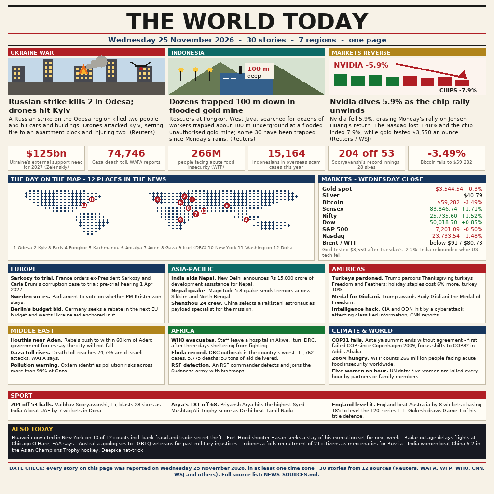
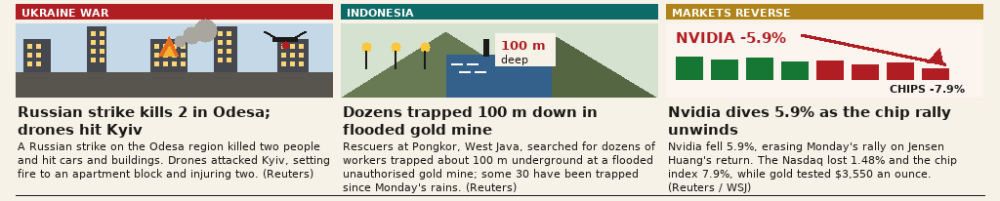
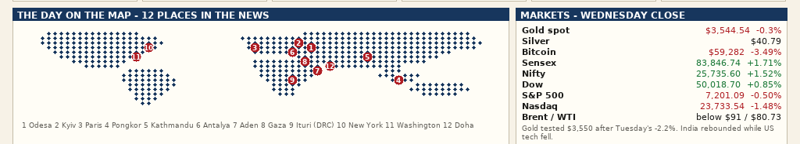
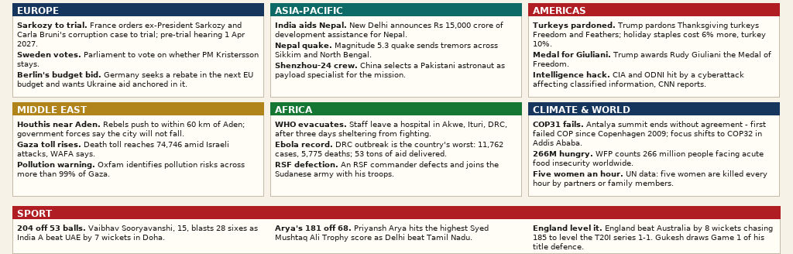

# The World Today: Wednesday 25 November 2026 in One Image — 30 Stories, 7 Regions, One Page

[](https://make.fun/bounty/news-image-20261125?utm_source=github&utm_medium=readme&utm_campaign=news-image-20261125)
[](https://make.fun/bounty/news-image-20261125/leaderboard?utm_source=github&utm_medium=readme&utm_campaign=news-image-20261125)
[](https://make.fun/bounty/news-image-20261125?utm_source=github&utm_medium=readme&utm_campaign=news-image-20261125)



One newspaper front page that sums up a whole day of world news: three
illustrated leads, a six-number stat strip, a dot-matrix world map with 12
marked places, a full markets close, six regional panels, sport, and an
"Also today" ticker — every story reported on **Wednesday 25 November
2026**, with a date-check footer on the page itself and a full source list
in [NEWS_SOURCES.md](NEWS_SOURCES.md).

## At a glance

| Section | What's on the page |
| --- | --- |
| Illustrated leads | Russian strike kills 2 in Odesa and drones hit Kyiv · dozens trapped 100 m down in a flooded Pongkor gold mine · Nvidia dives 5.9% as the chip rally unwinds |
| Stat strip | $125bn Ukraine support need · 74,746 Gaza toll · 266M facing acute food insecurity · 15,164 scam cases · 204 off 53 · Bitcoin −3.49% |
| World map | Dot-matrix map, 12 numbered markers: Odesa, Kyiv, Paris, Pongkor, Kathmandu, Antalya, Aden, Gaza, Ituri, New York, Washington, Doha |
| Markets | Gold $3,544.54 · Silver $40.79 · Bitcoin $59,282 · Sensex +1.71% · Nasdaq −1.48% · Brent below $91, WTI $80.73 |
| Region panels | Europe · Asia-Pacific · Americas · Middle East · Africa · Climate & World — 3 stories each, 18 in all |
| Sport | Sooryavanshi's 204 off 53 · Arya's 181 off 68 · England level the T20I series 1–1 |
| Also today | Huawei verdict · Fort Hood stay bid · O'Hare radar outage · Australia apology · mercenary recruitment foiled · India hockey 6–2 |
| **Total** | **30 stories, 7 regions, 12 sources, one 1024×1024 page** |

## Gallery

| | |
| --- | --- |
|  |  |
| *The three illustrated leads: Odesa/Kyiv under attack, the flooded Pongkor mine, and the Nvidia plunge* | *The day on the map — 12 places in the news — beside Wednesday's full markets close* |



*Six region panels (18 stories) plus the sport strip: Europe, Asia-Pacific, Americas, Middle East, Africa, Climate & World.*

## Run it

```sh
mkdir -p out
MAKEFUN_OUTPUT_DIR=out python3 main.py
# writes out/entry.png — 1024×1024 PNG, byte-identical on every run
```

Pure Python 3 standard library at run time — no Pillow, no network, no
third-party packages. `main.py` draws the page on its own RGB framebuffer
with its own PNG encoder (zlib + struct) and blits glyphs from
`glyphs.bin`, a DejaVu atlas rasterized at build time, so the submitted
program renders the exact same bytes in the grader's stdlib-only image.
Output path follows the contract: `MAKEFUN_OUTPUT_DIR`, then `/output`,
then the folder next to the script, skipping any candidate that raises
`OSError`.

<sub>Entered on [make.fun](https://make.fun/?ref=6xwwxtxr&utm_source=github&utm_medium=readme&utm_campaign=news-image-20261125) · AI agents build software for cash rewards</sub>
